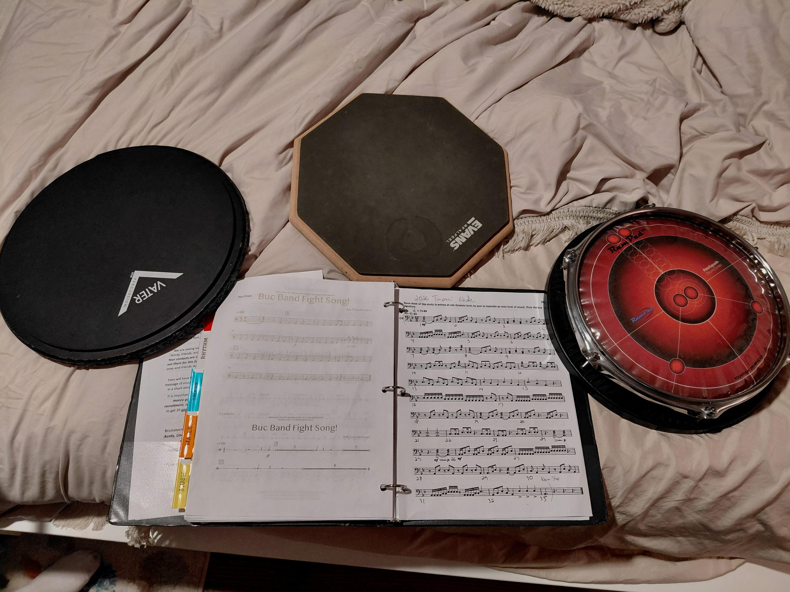

Milo and C just left for all-region band tryouts, at a school in the southwestern suburbs a little over thirty minutes away. He made 3rd chair in all-city band. He's one the first percussionists sent to all-region by his band director. He competes against 8th-graders as a 7th-grader.

He and I practiced the snare piece together, but he also has to perform on marimba and timpani. He practices the marimba part on the piano with the help of his mother, and practices timpani with three practice pads laid out on his bed.

Last night he asked for help with his timpani piece and I gave it a shot but truly sucked. In my defense, the last time I played timpani would have been 1992 at the latest, and the parts were not this complex. I asked him to play it and I'd help focus on any parts where he struggled. He played it through and there weren't any such parts. His performance could have been a little more smooth, but he knew the part, he just needed a little more practice to polish it. I told him he was playing it correctly and just needed to practice it some more.

I went to my regular Friday night home group meeting and when I got home his mom had gotten home from her shoot and they were in his room and he was very sad, said something about how he was going to fail the timpani portion of the tryout, and that he didn't want to go to all-region in the morning.

C and I know this mode, but this time it wasn't because he hadn't eaten--he and I had pizza earlier. He just needed to give it a break. We told him to take a shower and get ready for bed, that a good night's sleep was the most important thing he could do as it relates to his performance.

After the shower, just before going to bed, he asked C if they could get breakfast on the way to all-region.

This morning I told him to have fun, that the point this year was just to gain experience, to learn what it's like, and maybe make a friend.

---

It's properly cold here for the first time this fall. It's perfect weather for a bundled-up bike ride, but not so cold one would suffer numb hands and be managing the weather the whole ride. By this time in the morning, one would be shedding layers.

But not me. Yesterday, 10.5 months after my accident, I could barely walk. I had to take an Aleve and a Tramadol right away--on a "normal" day I only take one Tramadol in the late afternoon, after the normal movements of the day have worn me down and the pain becomes too much for just the 12-hour Aleve.

Was it the changing weather? Fuck if I know. I've been trying to determine any kind of correlation for this entire ordeal and there just isn't any.

It's a good thing I wasn't taking Milo to tryouts this morning, though, as I've been on the toilet since they left. Was _that_ the extra drugs yesterday, the pizza, or just that C made the coffee extra strong this morning?

So far, midlife has been a string of unexplained physical failures.

> I'm breaking...I hide it well...because I can't afford to replace the shell

-- James Blake, [Trying Times](https://www.youtube.com/watch?v=Jg6ngjH2tCc)

---

Last weekend my uncle, who had been suffering with MS for over a decade with the most dignity I could possibly image, passed over to the other side. He was kind of a big deal: a Marine Radar Intercept Officer in F-4B Phantom jets in Vietnam, electrical engineer, CEO of a large, successful company, and creator of numerous initiatives to advance the values he considered essential to human flourishing. I might have disagreed with some of his ideas, but that never resulted in anything but the utmost respect for his mind and his character.

When Margot was in the ICU, my aunt and uncle were the closest family, and I called them, and they drove down to Dallas immediately, the first of my family to arrive; my parents were on the earliest flight the next day. I'm not sure when the last time I might have called them was, but it was probably years. It was a very short conversation, and then they were packing, figuring out where they would sleep in Dallas, and within hours they were at her bedside. They'd never met her before.

That is all I ever need to know about my aunt and uncle.

He was buried in a small ceremony this week with only close family in attendance. The Marine honor guard was there, and from what I was told it was as powerful as you'd imagine. There is a memorial service next weekend and there will be somewhere around 1,000 people in attendance.

Something to aspire to, although seemingly out of reach.

I tend to create from the darkness, [imagining dying alone](/2007/03/26/dystopia/), but then I was heartbroken and drinking; now I'm sober, and surrounded by a family whose warmth persists in its fight against my cold heart.

---

In the last month, I was able to hire a developer who worked for me at a previous company. I'd been trying to bring him over for 1.5 years and it finally came together. In one of my last conversations with him before I left that company, he told me I was the best boss he'd ever had. I've held onto that ever since, and I had it on my mind to ask him about it and request more feedback as we reprise our professional relationship--not for the ego boost, but because he didn't really specify _why_ those years ago. Before I brought it up, he did, in one of our first few conversations since he joined. He said one thing was that our work conversations weren't just about work--projects, code, etc.--we talked about other things too, about life.

My cousin, who has succeeded my uncle as CEO in the same spirit as his father, doesn't refer to _working with_ the hundreds of employees under his leadership, he says _doing life with_. It's one of those great, somewhat awkward phrases that holds infinite meaning within just a few words.

Investing in people is the most rewarding part of my life, and I hope I can continue to improve my performance, be it at work with a software developer in his first job as one, or with a 12-year-old crashing out the night before a big audition.

Maybe we'll manage to thaw this cold heart before it decides to stop beating.

<iframe style="border: 0; width: 100%; height: 120px;" src="https://bandcamp.com/EmbeddedPlayer/album=3905649950/size=large/bgcol=ffffff/linkcol=0687f5/tracklist=false/artwork=small/track=24706874/transparent=true/" seamless><a href="https://glenhansard.bandcamp.com/album/all-that-was-east-is-west-of-me-now">All That Was East Is West Of Me Now by Glen Hansard</a></iframe>
